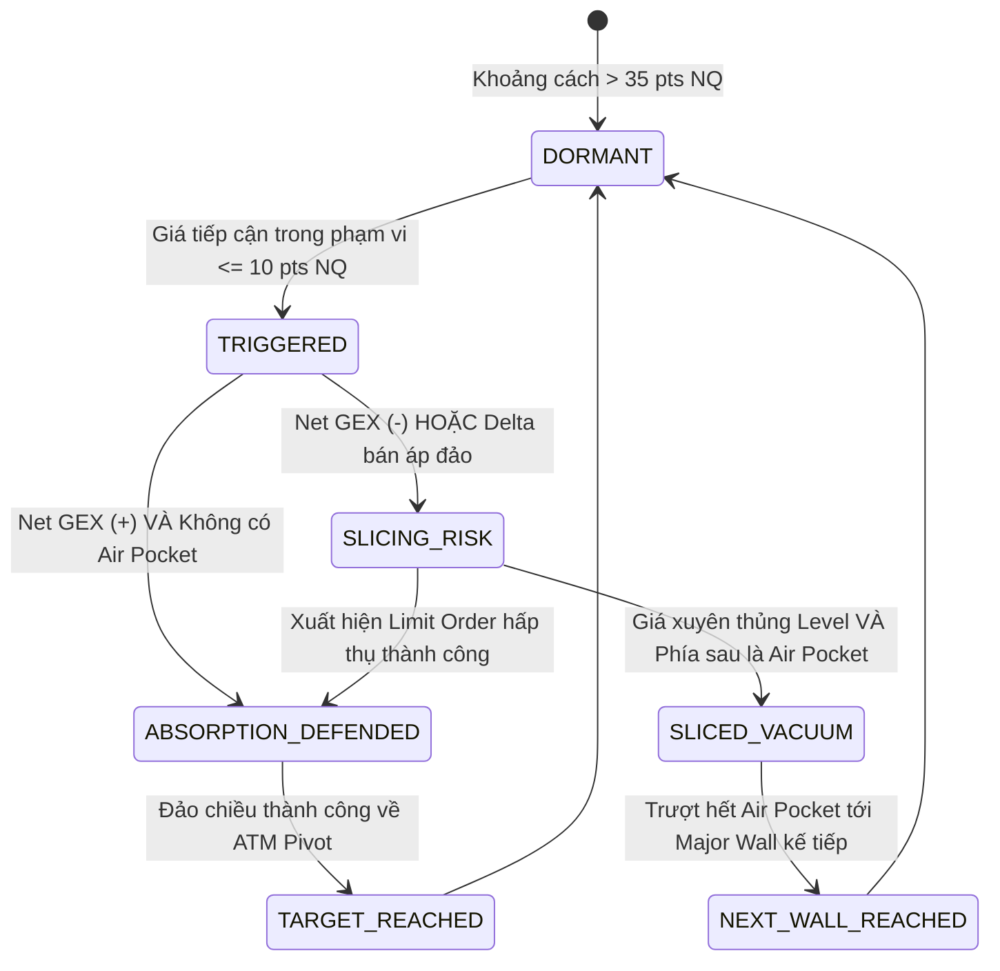

# Kiến trúc Hệ thống: Cloud Database & Collector cho E-mini Nasdaq

> **Project:** Neiro-NQ-Quant  
> **Phiên bản:** v2.0 (Kế thừa & Nâng cấp toàn diện từ kiến trúc chuẩn Neiro-Quant)  
> **Tài sản mục tiêu:** E-mini Nasdaq-100 Futures (`NQ`), Micro E-mini (`MNQ`), QQQ Invesco ETF Options & NDX Index Options.

---

## I. TỔNG QUAN KIẾN TRÚC TOÀN CẢNH (END-TO-END PIPELINE)

Hệ thống được thiết kế theo tư duy **Cloud-First & Zero-Waste**, chạy hoàn toàn trên nền tảng đám mây Google Colab, giải phóng hoàn toàn laptop người dùng khỏi gánh nặng lưu trữ dữ liệu thô:

```
+-----------------------------------------------------------------------------------+
|                            TẦNG 1: NGUỒN DỮ LIỆU ĐÁM MÂY                          |
|    - yfinance API (QQQ & NDX Options Chains, 0DTE to Monthly)                     |
|    - CBOE Delayed API / Free Option Feed                                          |
|    - US Treasury Yield 3M (Risk-Free Rate r) & Nasdaq Spot/Futures Proxy          |
+-----------------------------------------------------------------------------------+
                                          │
                                          ▼
+-----------------------------------------------------------------------------------+
|                            TẦNG 2: COLLECTOR ĐẦU TIÊN (COLAB / PYTHON)            |
|    - symbols_resolver: Tự động phát hiện ngày đáo hạn gần nhất (0DTE/Weekly).     |
|    - chain_fetcher: Quét toàn bộ Calls & Puts (Bid, Ask, Mid, Volume, OI, IV).    |
|    - greeks_engine: Vectorized Black-Scholes tính Delta, Gamma, Vanna, Charm.     |
|    - basis_mapper: Tự động ánh xạ tỷ lệ giá giữa QQQ/NDX và HĐTL E-mini NQ.       |
+-----------------------------------------------------------------------------------+
                                          │
                    ┌─────────────────────┴─────────────────────┐
                    ▼                                           ▼
+-----------------------------------------+   +-------------------------------------+
|    TẦNG 3: CLOUD DATABASE (LƯU TRỮ)     |   |    TẦNG 4: LÕI ĐỊNH LƯỢNG (ENGINE)  |
|                                         |   |                                     |
|  [Google Drive Cold Storage]            |   |  - Cây tri thức định lượng 3 tầng   |
|  /MyDrive/Neiro-NQ-Quant/data/          |   |  - GEX & DEX Matrix Profile         |
|  └── options/symbol=QQQ/year=.../       |   |  - Synthetic ATM Pivot & Straddle   |
|      └── snapshot_YYYYMMDD_HHMM.parquet |   |  - ±1.0σ & ±2.0σ Expected Move      |
|                                         |   |  - Call Wall & Put Wall Strikes     |
|  [DuckDB Serverless Query Engine]       |   |  - Pin Risk Magnet & Gamma Triggers |
|  Truy vấn SQL tức thì trên Parquet      |   |  - OI Air Pockets (Vùng trượt giá)  |
+-----------------------------------------+   |  - Level State Machine Engine       |
                    │                         +-------------------------------------+
                    │                                           │
                    └─────────────────────┬─────────────────────┘
                                          ▼
+-----------------------------------------------------------------------------------+
|                        TẦNG 5: INTERACTIVE DASHBOARD & AI BRIEFING                |
|    - Bảng điều khiển tương tác Plotly ATAS Dark Theme (Zoom, Pan, Tooltip Strike) |
|    - 3 Panels chuẩn mực: Net GEX Profile | Cumulative Gamma Curve | Delta Flow    |
|    - Radar State Machine giám sát trạng thái từng cản theo thời gian thực         |
|    - Tactical Briefing Generator (DeepSeek / Gemini AI prompt):                   |
|      + Chế độ thị trường (Positive GEX Mean-reverting vs Negative GEX Trending)   |
|      + Kế hoạch tác chiến từng phiên (Á, Âu, Mỹ): Vùng mua, vùng bán, SL, TP      |
+-----------------------------------------------------------------------------------+
```

---

## II. THIẾT KẾ CHI TIẾT CLOUD DATABASE ĐÁM MÂY

### 1. Phân tầng Lưu trữ (Multi-Tier Storage Strategy)

| Tầng lưu trữ | Nền tảng | Định dạng | Mục đích | Chi phí & Tài nguyên |
|---|---|---|---|---|
| **Cold Storage (Lịch sử)** | Google Drive | Apache Parquet (Snappy) | Lưu giữ toàn bộ snapshot lịch sử Options Chain theo từng phút/phiên | 0 VNĐ (Dùng Google Drive cá nhân, nén 85%) |
| **Warm Engine (Truy vấn)** | DuckDB Embedded | In-Memory / Virtual Tables | Thực thi các câu lệnh SQL phân tích chuỗi thời gian GEX mà không cần cài server database | 0 VNĐ (Chạy trên RAM của Colab) |
| **Hot Cache (Tác chiến)** | Polars / Pandas DataFrame | RAM Colab & JSON | Cung cấp dữ liệu tức thì cho Bảng điều khiển Plotly và Prompt AI | Tốc độ tính toán < 50ms |

### 2. Cấu trúc Thư mục Phân vùng Parquet (Partitioning Scheme)

Trên Google Drive của người dùng (tự động mount tại `/content/drive/MyDrive/Neiro-NQ-Quant/`):
```
Neiro-NQ-Quant/
└── data/
    ├── options/
    │   └── symbol=QQQ/
    │       └── year=2026/
    │           └── month=10/
    │               └── date=2026-10-18/
    │                   ├── snapshot_093000.parquet
    │                   ├── snapshot_120000.parquet
    │                   └── snapshot_160000.parquet
    ├── daily_summary/
    │   └── symbol=NQ/
    │       └── nq_levels_history.parquet
    └── exports/
        └── latest_dashboard.html
```

---

## III. THIẾT KẾ CHI TIẾT COLLECTOR ĐẦU TIÊN CHO E-MINI NASDAQ

### 1. Vì sao chọn QQQ Options làm Proxy số 1 cho E-mini Nasdaq?

- **Khối lượng giao dịch khổng lồ:** QQQ là một trong những tài sản có thanh khoản Options lớn nhất thế giới, tập hợp đầy đủ các Market Makers (Citadel, Jane Street, Susquehanna, Virtu).
- **Kỳ hạn 0DTE hàng ngày:** QQQ đáo hạn mỗi ngày (Thứ 2 đến Thứ 6), tạo ra áp lực tái phòng hộ (Gamma Scalping / 0DTE Hedging) trực tiếp lên chỉ số Nasdaq-100 và Hợp đồng Tương lai E-mini Nasdaq (`NQ`).
- **Tỷ lệ ánh xạ (Basis Ratio):**
  $$NQ_{Price} \approx QQQ_{Price} \times \text{Basis Factor}$$
  Ví dụ: Khi QQQ = 500.00, NQ Futures = 20,500.00 $\rightarrow$ Tỷ lệ ánh xạ $\approx 41.0$. Mọi bức tường Call Wall, Put Wall, và vùng chân không của QQQ đều được nhân với hệ số này để ra mốc giá E-mini Nasdaq tương ứng!

### 2. Chu trình Thu thập (Collection Workflow)

```
[Khởi động Collector]
         │
         ▼
[1. Quét danh sách Expiration Dates của QQQ qua yfinance]
         │
         ▼
[2. Nhận diện kỳ hạn mục tiêu (Target DTE)]
   - Mặc định: 0DTE (kỳ hạn đáo hạn trong ngày hôm nay)
   - Nếu ngoài giờ giao dịch / cuối tuần: Kỳ hạn giao dịch kế tiếp (Next Trading Day)
         │
         ▼
[3. Tải toàn bộ Calls Chain & Puts Chain]
   - Strike, Bid, Ask, Mid, Last Price, Volume, Open Interest, Implied Volatility
   - LUÔN DÙNG Mid = (Bid + Ask)/2, LOẠI BỎ hoàn toàn giá khớp trễ Latest
         │
         ▼
[4. Giải bài toán Vectorized Greeks (Black-Scholes Engine)]
   - Tính toán chính xác Delta, Gamma, Vega, Vanna, Charm cho từng Strike
         │
         ▼
[5. Lưu trữ Parquet vào Google Drive / Cache]
         │
         ▼
[6. Đẩy dữ liệu vào Lõi Quant Engine để vẽ Dashboard]
```

---

## IV. CÂY TRI THỨC ĐỊNH LƯỢNG 3 TẦNG (3-TIER QUANT KNOWLEDGE TREE TỪ NEIRO-QUANT)

Kế thừa trực tiếp cấu trúc định lượng chuẩn từ dự án `Neiro-Quant`:

```
               [TIER 3: DEALER POSITIONING & RISK ENVELOPE]
         Call Wall #1 | Put Wall #1 | Pin Risk Magnet | Gamma Squeeze
                         Air Pockets (< 35% OI Mean)
                                      ▲
                                      │
                 [TIER 2: IMPLIED VALUATION & STRADDLE BANDS]
            Synthetic ATM Pivot (Put-Call Parity) | ATM Straddle
            ±1.0σ Implied Bands | ±0.85σ 0DTE Conservative Bands
                                      ▲
                                      │
               [TIER 1: MARKET MICROSTRUCTURE & LIQUIDITY]
            Mid-Price = (Bid + Ask)/2 | Pure Open Interest (OI)
                     Vectorized Greeks (Δ, Γ, ν, Vanna, Charm)
```

### 1. Tier 1: Cấu trúc Vi mô (Market Microstructure)
- Triệt tiêu hoàn toàn sai lệch từ giá khớp trễ (`Latest`), luôn chuẩn hóa qua giá trung bình Market Maker:
  $$Mid = \frac{Bid + Ask}{2}$$

### 2. Tier 2: Trục Định giá Ngầm định (Implied Valuation)
- **Synthetic ATM Pivot ($S_{Implied}$):** Dựa trên nguyên lý Ngang giá Quyền chọn (Put-Call Parity) tìm Strike $K_{ATM}$ có $|Call_{mid} - Put_{mid}|$ nhỏ nhất:
  $$S_{Implied} = K_{ATM} + e^{rT} \left( Call_{mid} - Put_{mid} \right)$$
- **Biên độ Kỳ vọng (ATM Straddle):**
  $$Straddle = Call_{mid}(ATM) + Put_{mid}(ATM)$$
- **Dải biên độ 1-Sigma:**
  $$Upper\ Band\ (+1\sigma) = S_{Implied} + Straddle$$
  $$Lower\ Band\ (-1\sigma) = S_{Implied} - Straddle$$
  *(Hệ số điều chỉnh cho 0DTE là $0.85 \times Straddle$)*

### 3. Tier 3: Vị thế Nhà tạo lập (Dealer Positioning)
- **Call Wall #1:** Strike có $OI_{Call}$ lớn nhất $\rightarrow$ Trần cự kháng cự dương Gamma.
- **Put Wall #1:** Strike có $OI_{Put}$ lớn nhất $\rightarrow$ Bệ đỡ hỗ trợ âm Gamma.
- **Pin Risk Magnet (Hố đen ghim giá):** Strike có tổng $(OI_{Call} + OI_{Put})$ cao nhất toàn thị trường.
- **Gamma Squeeze Triggers:**
  $$Trigger_{Up} = Strike_{CallWall} + Call_{mid}(CallWall)$$
  $$Trigger_{Down} = Strike_{PutWall} - Put_{mid}(PutWall)$$
  Khi nến M5 đóng cửa vượt qua các mốc này, Dealer buộc phải quét lệnh khẩn cấp để stop loss.
- **OI Air Pockets (Vùng chân không thanh khoản):** Các strike có $OI < 0.35 \times \text{Mean}(OI_{all})$. Khi giá rơi vào vùng này, gia tốc trượt giá sẽ tăng cực đại do thiếu lực đỡ.

---

## V. CƠ CHẾ STATE MACHINE CHO TỪNG LEVEL (LEVEL STATE ENGINE)

Hệ thống giám sát khoảng cách giá thực tế của E-mini Nasdaq tới các mốc cản theo chu trình State Machine:



### Quy tắc tác chiến cốt lõi:
1. **Khi cản ở trạng thái `ABSORPTION_DEFENDED` (Trụ vững - Fade Reversal):**
   - Đặt lệnh Limit đảo chiều khi nến M1/M5 rút chân trong cản.
   - SL cực ngắn: 15 - 25 điểm NQ (~0.5 - 0.7 giá QQQ).
   - TP: Trục cân bằng ATM Pivot hoặc mốc cản đối diện.
2. **Khi cản ở trạng thái `SLICED_VACUUM` (Đâm thủng - Trượt dốc):**
   - **LỆNH CẤM TỐI CAO:** **TUYỆT ĐỐI KHÔNG BẮT ĐÁY / KHÔNG ĐỠ DAO**.
   - Chuyển sang chiến thuật **Breakout Runner** đánh xuôi theo đà trượt giá xuống bức tường tiếp theo.

---

## VI. CƠ CHẾ DUAL-FRAME EXPIRATION (NGẮN HẠN & DÀI HẠN)

Hệ thống tự động hỗ trợ 2 khung nhìn:
- **Khung Intraday (0DTE / Weekly):** Thu thập Options đáo hạn trong ngày để đo lường áp lực Gamma Scalping tức thời của Market Maker.
- **Khung Institutional (Monthly / Quarterly):** Thu thập Options đáo hạn tháng/quý để nắm bắt vị thế bảo hiểm phòng hộ (Structural Hedging) của các quỹ đầu tư tổ chức.
