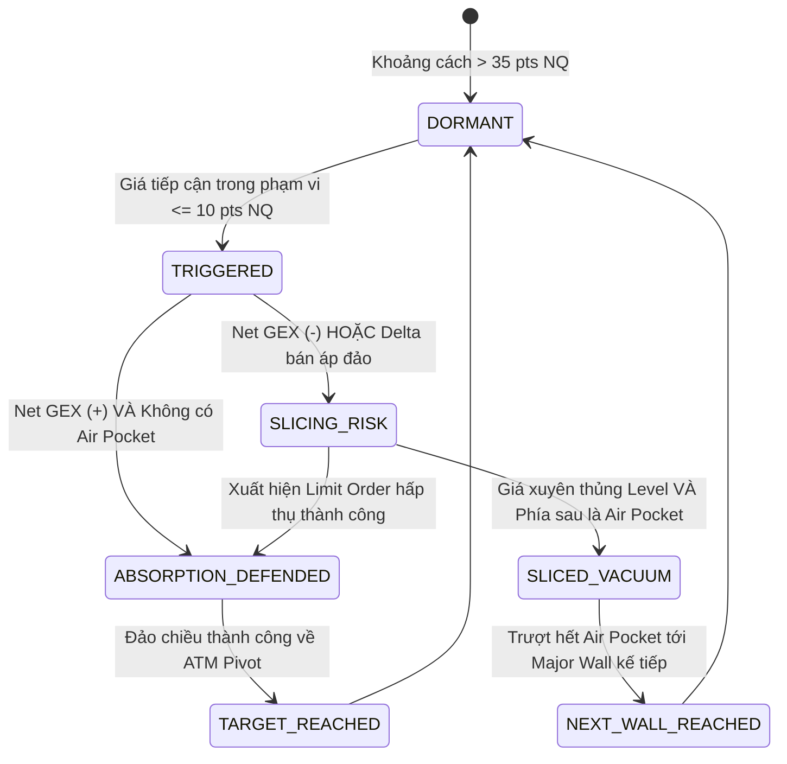

# Kiến trúc Hệ thống: Cloud-Native Automation & Quant Terminal cho E-mini Nasdaq

> **Project:** Neiro-NQ-Quant  
> **Phiên bản:** v3.0 (Cloud-Native Zero-Touch Automation & Black-76 Microstructure Engine)  
> **Tài sản mục tiêu:** E-mini Nasdaq-100 Futures (`NQ` / `NQZ26`), Micro E-mini (`MNQ`), Spot Broker Index (`NAS100` / `US100`), và Invesco QQQ Trust Options.

---

## I. TỔNG QUAN KIẾN TRÚC TOÀN CẢNH (END-TO-END PIPELINE)

Hệ thống được thiết kế theo tư duy **Cloud-Native 100% & Zero-Waste**, vận hành hoàn toàn tự động trên **GitHub Actions Runner** theo **Lưới Cron Đa Tầng Pre-Session Radar & Dual-Stage Thích Ứng 2 Mùa**, tự động xuất bản lên **GitHub Pages**, giải phóng hoàn toàn máy tính người dùng:

```
+-----------------------------------------------------------------------------------+
|                        TẦNG 1: NGUỒN DỮ LIỆU ĐÁM MÂY (LIVE & FREE)                |
|    - yfinance API (QQQ Options Chains: 150+ Strikes, 0DTE Hàng Ngày)              |
|    - Vượt tường lửa Cloudflare 100%, thực thi < 4 giây, không tốn Chromium 300MB   |
|    - US Treasury Yield 3M (Risk-Free Rate r) & Tỷ giá Futures CME                 |
|    - Benchmark Synthetic Chain Generator dự phòng khi ngoài giờ giao dịch         |
+-----------------------------------------------------------------------------------+
                                          │
                                          ▼
+-----------------------------------------------------------------------------------+
|               TẦNG 2: THU THẬP & CHUẨN HÓA (COLLECTOR & DATA ENGINE)               |
|    - symbols_resolver: Tự động phát hiện ngày đáo hạn gần nhất (0DTE/Weekly).     |
|    - chain_fetcher: Quét toàn bộ Calls & Puts (Bid, Ask, Mid, Volume, OI, IV).    |
|    - NaN-Safe Converter: Bảo vệ số liệu Volume/OI không bị văng Exception.        |
|    - basis_mapper: Ánh xạ chuẩn xác giữa QQQ/NDX và HĐTL E-mini NQ ($20/pt).      |
+-----------------------------------------------------------------------------------+
                                          │
                    ┌─────────────────────┴─────────────────────┐
                    ▼                                           ▼
+-----------------------------------------+   +-------------------------------------+
|    TẦNG 3: CLOUD STORAGE & CI/CD        |   |   TẦNG 4: LÕI BLACK-76 QUANT ENGINE |
|                                         |   |                                     |
|  [GitHub Actions Pre-Session Radar Grid]|   |  - Black-76 Valuation ($e^{-rT}$)   |
|  14 runs/ngày (CME, Âu 2 nấc, Mỹ 0DTE)  |   |  - Hybrid Newton-Brent IV Solver    |
|  Chạy tự động đón đầu mở phiên 30-45p   |   |  - Greeks Bậc 1 & 2: Δ, Γ, ν, V, C  |
|                                         |   |  - Put-Call Parity Synthetic Pivot  |
|  [Snapshot & Parquet Storage]           |   |  - Net GEX ($M/1%), Net VEX, CHEX   |
|  options_prices_NQZ26.csv (< 50KB)      |   |  - Brenner-Subrahmanyam 1-Sigma EM  |
|  Zero-Waste Mandate (< 15MB toàn repo)  |   |  - Rule of 16 Intraday Volatility   |
|                                         |   |  - Call/Put Walls & Air Pockets     |
+-----------------------------------------+   |  - Level State Machine Engine       |
                    │                         +-------------------------------------+
                    │                                           │
                    └─────────────────────┬─────────────────────┘
                                          ▼
+-----------------------------------------------------------------------------------+
|               TẦNG 5: TACTICAL TERMINAL HUD & GITHUB PAGES EXPORT                 |
|    - Bảng điều khiển tương tác Plotly Dark HUD 3 Panels (Horizontal Price Ladder):|
|      * Panel 1: Net GEX Profile ($M) & Mốc Chiến Thuật Dynamic                    |
|      * Panel 2: Khối lượng (Volume) vs Mật độ Open Interest nén                   |
|      * Panel 3: Greeks Bậc 2 tương tác (Vanna & Charm Flow)                       |
|    - Anti-Collision Layout (Legend y=1.07, Spot CME x=0.98, Vertical Separation)  |
|    - 2 Bảng Chiến thuật: Intraday Scalping (30-50 pts) & Structural Swing Walls   |
|    - Đồng bộ độ lệch Spot Broker MT5 qua tham số --basis                          |
|    - Tự động Deploy lên GitHub Pages (gh-pages) xem trực tiếp trên mọi thiết bị   |
+-----------------------------------------------------------------------------------+
```

---

## II. LƯỚI CRON ĐA TẦNG PRE-SESSION RADAR & PHÂN TẦNG LƯU TRỮ

### 1. Lưới Cron Đa Tầng Pre-Session Radar & Dual-Stage 0DTE

Áp dụng mô hình **3 Khối Cron chuyên biệt** (`14 lần chạy/ngày, Thứ 2 - Thứ 6`) tối ưu 100% cho cấu trúc E-mini Nasdaq & QQQ Options:

```yaml
on:
  schedule:
    # 1. Chot Open Interest ngay moi tu CME Clearing (07:15 VN):
    - cron: '15 0 * * 1-5'

    # 2. Phien Au 2 nac (Pre-Europe & In-Session Europe thich ung ca 2 mua):
    - cron: '30 5,6,7,8 * * 1-5'

    # 3. Phien My don tin vi mo (18:45 VN), gio cao diem NYSE & 0DTE Power Hour (02:45 VN):
    - cron: '45 11,12,13,14,15,16,17,18,19 * * 1-5'
```

#### Ma trận Lịch trình Tác chiến (UTC vs Giờ Việt Nam):

| Khối | Giờ UTC | Giờ VN (UTC+7) | Sự kiện Thị trường & Mục đích Tác chiến |
|---|---|---|---|
| **Khối 1: CME Clearing** | **00:15 UTC** | **07:15 VN** | **Chốt Open Interest CME Clearing & OCC:** OCC & CME công bố sổ lệnh OI chính thức cho ngày mới. Vì OI giữ tĩnh suốt cả ngày giao dịch, bước này chốt cố định **Call Wall, Put Wall & Max Pain** khung ngày chuẩn xác 100%. |
| **Khối 2: Phiên Âu Nấc 1** | **05:30 UTC** | **12:30 VN** | **Pre-Europe Radar (Mùa Hè):** Quét trước khi sàn Frankfurt mở (13:00 VN) và London mở (14:00 VN) 30–90 phút để lên kịch bản đánh Futures NQ Globex / US100 ban ngày. |
| | **06:30 UTC** | **13:30 VN** | **Pre-Europe Radar (Mùa Đông):** Quét trước khi sàn Frankfurt mở (14:00 VN) và London mở (15:00 VN) khi Châu Âu chuyển giờ mùa đông. |
| **Khối 2: Phiên Âu Nấc 2** | **07:30 UTC** | **14:30 VN** | **In-Session Europe (Mùa Hè):** Cập nhật sau khi London chạy 30 phút, đo lường phản ứng giá thực tế và dịch chuyển Delta/Gamma tức thời. |
| | **08:30 UTC** | **15:30 VN** | **In-Session Europe (Mùa Đông):** Cập nhật sau khi London chạy 30 phút trong mùa đông. |
| **Khối 3: Pre-US Macro** | **11:45 UTC** | **18:45 VN** | **Pre-US Macro News Radar:** Đón đầu trước các tin tức vĩ mô tối quan trọng của Mỹ (CPI, PPI, Non-Farm Payrolls lúc 19:30 hè / 20:30 đông) từ 45-105 phút. |
| **Khối 3: Pre-Market US** | **12:45 UTC** | **19:45 VN** | **Pre-Market NYSE (Mùa Hè):** Quét trước giờ mở cửa sàn giao dịch chứng khoán New York (20:30 VN) 45 phút. |
| **Khối 3: Cao điểm Phiên Mỹ** | **13:45 UTC** | **20:45 VN** | **In-Session Mùa Hè** (sau mở cửa 15p, options QQQ bắt đầu có volume thực) / **Pre-Market NYSE Mùa Đông** (trước mở cửa 21:30 VN 45 phút). |
| | **14:45 UTC** | **21:45 VN** | **Cao điểm sôi động Mùa Hè (10:45 AM EDT)** / **In-Session Mùa Đông** (sau mở cửa 15p). |
| | **15:45 UTC** | **22:45 VN** | **Xuyên suốt giữa phiên Mỹ (Mid-Session):** Cập nhật biến động Volatility Squeeze & dịch chuyển Put-Call Parity. |
| | **16:45 UTC** | **23:45 VN** | **Đón đầu London Fix (00:00 VN):** Nhịp tái cân bằng dòng tiền giữa 2 lục địa Âu - Mỹ. |
| | **17:45 UTC** | **00:45 VN** | **Nửa sau phiên Mỹ:** Theo dõi sự hấp thụ thanh khoản và xu hướng phiên chiều New York. |
| | **18:45 UTC** | **01:45 VN** | **Chuẩn bị vào Giờ Vàng Power Hour (14:45 EDT / 13:45 EST):** Nhận diện các bẫy thanh khoản cuối ngày. |
| **Khối 3: 0DTE Power Hour** | **19:45 UTC** | **02:45 VN** | **0DTE Power Hour Radar & Market Close:** Đón đầu trước khi sàn NYSE đóng cửa (03:00 hè), bắt trọn áp lực **Gamma Pinning / Gamma Unwind** khốc liệt của các nhà tạo lập thị trường đối với hợp đồng 0DTE đáo hạn trong ngày. |

### 2. Phân tầng Lưu trữ & Zero-Waste

| Tầng lưu trữ | Nền tảng | Định dạng | Mục đích | Chi phí & Tài nguyên |
|---|---|---|---|---|
| **Ephemeral Runner** | GitHub Actions Ubuntu | In-Memory | Chạy pipeline thu thập, giải Black-76 và xuất HTML (< 20 giây) | 0 VNĐ (GitHub Free Tier 2,000 phút/tháng) |
| **Active Options Snapshot** | GitHub Repository | CSV (`data/options_prices_NQZ26.csv`) | Lưu trữ snapshot phục vụ chạy benchmark và fallback | Dung lượng < 50 KB |
| **Interactive Terminal Web** | GitHub Pages (`gh-pages`) | HTML độc lập (`exports/index.html`) | Truy cập trực tiếp qua link Web trên điện thoại / PC | 0 VNĐ (Miễn phí vĩnh viễn) |
| **Tactical Levels Feed** | GitHub Pages (`gh-pages`) | JSON (`exports/nq_tactical_levels.json`) | Nạp vào Bot Telegram, Discord hoặc MetaTrader EA | Dung lượng < 3 KB |
| **Cold Storage (Tùy chọn)** | Google Drive | Apache Parquet (Snappy) | Lưu giữ toàn bộ snapshot lịch sử Options Chain theo từng phút/phiên | 0 VNĐ (Dùng Google Drive cá nhân, nén 85%) |


### 2. Cấu trúc Thư mục Phân vùng Parquet (Partitioning Scheme)

Trên Google Drive của người dùng (tự động mount tại `/content/drive/MyDrive/Neiro-NQ-Quant/`):
```
Neiro-NQ-Quant/
└── data/
    ├── options/
    │   └── symbol=QQQ/
    │       └── year=2026/
    │           └── month=10/
    │               └── date=2026-10-18/
    │                   ├── snapshot_093000.parquet
    │                   ├── snapshot_120000.parquet
    │                   └── snapshot_160000.parquet
    ├── daily_summary/
    │   └── symbol=NQ/
    │       └── nq_levels_history.parquet
    └── exports/
        └── latest_dashboard.html
```

---

## III. THIẾT KẾ CHI TIẾT COLLECTOR ĐẦU TIÊN CHO E-MINI NASDAQ

### 1. Vì sao chọn QQQ Options làm Proxy số 1 cho E-mini Nasdaq?

- **Khối lượng giao dịch khổng lồ:** QQQ là một trong những tài sản có thanh khoản Options lớn nhất thế giới, tập hợp đầy đủ các Market Makers (Citadel, Jane Street, Susquehanna, Virtu).
- **Kỳ hạn 0DTE hàng ngày:** QQQ đáo hạn mỗi ngày (Thứ 2 đến Thứ 6), tạo ra áp lực tái phòng hộ (Gamma Scalping / 0DTE Hedging) trực tiếp lên chỉ số Nasdaq-100 và Hợp đồng Tương lai E-mini Nasdaq (`NQ`).
- **Tỷ lệ ánh xạ (Basis Ratio):**
  $$NQ_{Price} \approx QQQ_{Price} \times \text{Basis Factor}$$
  Ví dụ: Khi QQQ = 500.00, NQ Futures = 20,500.00 $\rightarrow$ Tỷ lệ ánh xạ $\approx 41.0$. Mọi bức tường Call Wall, Put Wall, và vùng chân không của QQQ đều được nhân với hệ số này để ra mốc giá E-mini Nasdaq tương ứng!

### 2. Chu trình Thu thập (Collection Workflow)

```
[Khởi động Collector]
         │
         ▼
[1. Quét danh sách Expiration Dates của QQQ qua yfinance]
         │
         ▼
[2. Nhận diện kỳ hạn mục tiêu (Target DTE)]
   - Mặc định: 0DTE (kỳ hạn đáo hạn trong ngày hôm nay)
   - Nếu ngoài giờ giao dịch / cuối tuần: Kỳ hạn giao dịch kế tiếp (Next Trading Day)
         │
         ▼
[3. Tải toàn bộ Calls Chain & Puts Chain]
   - Strike, Bid, Ask, Mid, Last Price, Volume, Open Interest, Implied Volatility
   - LUÔN DÙNG Mid = (Bid + Ask)/2, LOẠI BỎ hoàn toàn giá khớp trễ Latest
         │
         ▼
[4. Giải bài toán Vectorized Greeks (Black-Scholes Engine)]
   - Tính toán chính xác Delta, Gamma, Vega, Vanna, Charm cho từng Strike
         │
         ▼
[5. Lưu trữ Parquet vào Google Drive / Cache]
         │
         ▼
[6. Đẩy dữ liệu vào Lõi Quant Engine để vẽ Dashboard]
```

---

## IV. CÂY TRI THỨC ĐỊNH LƯỢNG 3 TẦNG (3-TIER QUANT KNOWLEDGE TREE TỪ NEIRO-QUANT)

Kế thừa trực tiếp cấu trúc định lượng chuẩn từ dự án `Neiro-Quant`:

```
               [TIER 3: DEALER POSITIONING & RISK ENVELOPE]
         Call Wall #1 | Put Wall #1 | Pin Risk Magnet | Gamma Squeeze
                         Air Pockets (< 35% OI Mean)
                                      ▲
                                      │
                 [TIER 2: IMPLIED VALUATION & STRADDLE BANDS]
            Synthetic ATM Pivot (Put-Call Parity) | ATM Straddle
            ±1.0σ Implied Bands | ±0.85σ 0DTE Conservative Bands
                                      ▲
                                      │
               [TIER 1: MARKET MICROSTRUCTURE & LIQUIDITY]
            Mid-Price = (Bid + Ask)/2 | Pure Open Interest (OI)
                     Vectorized Greeks (Δ, Γ, ν, Vanna, Charm)
```

### 1. Tier 1: Cấu trúc Vi mô (Market Microstructure)
- Triệt tiêu hoàn toàn sai lệch từ giá khớp trễ (`Latest`), luôn chuẩn hóa qua giá trung bình Market Maker:
  $$Mid = \frac{Bid + Ask}{2}$$

### 2. Tier 2: Trục Định giá Ngầm định (Implied Valuation)
- **Synthetic ATM Pivot ($S_{Implied}$):** Dựa trên nguyên lý Ngang giá Quyền chọn (Put-Call Parity) tìm Strike $K_{ATM}$ có $|Call_{mid} - Put_{mid}|$ nhỏ nhất:
  $$S_{Implied} = K_{ATM} + e^{rT} \left( Call_{mid} - Put_{mid} \right)$$
- **Biên độ Kỳ vọng (ATM Straddle):**
  $$Straddle = Call_{mid}(ATM) + Put_{mid}(ATM)$$
- **Dải biên độ 1-Sigma:**
  $$Upper\ Band\ (+1\sigma) = S_{Implied} + Straddle$$
  $$Lower\ Band\ (-1\sigma) = S_{Implied} - Straddle$$
  *(Hệ số điều chỉnh cho 0DTE là $0.85 \times Straddle$)*

### 3. Tier 3: Vị thế Nhà tạo lập (Dealer Positioning)
- **Call Wall #1:** Strike có $OI_{Call}$ lớn nhất $\rightarrow$ Trần cự kháng cự dương Gamma.
- **Put Wall #1:** Strike có $OI_{Put}$ lớn nhất $\rightarrow$ Bệ đỡ hỗ trợ âm Gamma.
- **Pin Risk Magnet (Hố đen ghim giá):** Strike có tổng $(OI_{Call} + OI_{Put})$ cao nhất toàn thị trường.
- **Gamma Squeeze Triggers:**
  $$Trigger_{Up} = Strike_{CallWall} + Call_{mid}(CallWall)$$
  $$Trigger_{Down} = Strike_{PutWall} - Put_{mid}(PutWall)$$
  Khi nến M5 đóng cửa vượt qua các mốc này, Dealer buộc phải quét lệnh khẩn cấp để stop loss.
- **OI Air Pockets (Vùng chân không thanh khoản):** Các strike có $OI < 0.35 \times \text{Mean}(OI_{all})$. Khi giá rơi vào vùng này, gia tốc trượt giá sẽ tăng cực đại do thiếu lực đỡ.

---

## V. CƠ CHẾ STATE MACHINE CHO TỪNG LEVEL (LEVEL STATE ENGINE)

Hệ thống giám sát khoảng cách giá thực tế của E-mini Nasdaq tới các mốc cản theo chu trình State Machine:



### Quy tắc tác chiến cốt lõi:
1. **Khi cản ở trạng thái `ABSORPTION_DEFENDED` (Trụ vững - Fade Reversal):**
   - Đặt lệnh Limit đảo chiều khi nến M1/M5 rút chân trong cản.
   - SL cực ngắn: 15 - 25 điểm NQ (~0.5 - 0.7 giá QQQ).
   - TP: Trục cân bằng ATM Pivot hoặc mốc cản đối diện.
2. **Khi cản ở trạng thái `SLICED_VACUUM` (Đâm thủng - Trượt dốc):**
   - **LỆNH CẤM TỐI CAO:** **TUYỆT ĐỐI KHÔNG BẮT ĐÁY / KHÔNG ĐỠ DAO**.
   - Chuyển sang chiến thuật **Breakout Runner** đánh xuôi theo đà trượt giá xuống bức tường tiếp theo.

---

## VI. CƠ CHẾ DUAL-FRAME EXPIRATION (NGẮN HẠN & DÀI HẠN)

Hệ thống tự động hỗ trợ 2 khung nhìn:
- **Khung Intraday (0DTE / Weekly):** Thu thập Options đáo hạn trong ngày để đo lường áp lực Gamma Scalping tức thời của Market Maker.
- **Khung Institutional (Monthly / Quarterly):** Thu thập Options đáo hạn tháng/quý để nắm bắt vị thế bảo hiểm phòng hộ (Structural Hedging) của các quỹ đầu tư tổ chức.

---

## VII. THIẾT KẾ GIAO DIỆN TÁC CHIẾN PLOTLY DARK HUD & THUẬT TOÁN CHỐNG ĐÈ CHỮ

### 1. Bố cục 3 Panels Thang giá Ngang (Horizontal Price Ladder)
- **Panel 1 (Bên trái): Net GEX Profile ($M):** Trực quan hóa bức tranh phòng hộ của Dealer theo từng mức giá. Cột xanh dương dương Gamma (Mean-reverting), cột cam âm Gamma (Trending/Squeeze). Tích hợp các mốc cản chiến thuật và SL/TP.
- **Panel 2 (Ở giữa): Dòng tiền Khối lượng (Volume) vs Open Interest nén:** Cột xanh lá đo lường thanh khoản Volume đang giao dịch, đường bậc thang vàng thể hiện mật độ vị thế mở Open Interest của tổ chức.
- **Panel 3 (Bên phải): Greeks Bậc 2 Tương tác (Vanna & Charm):** Đo lường áp lực phòng hộ nhạy theo Độ biến động ngầm định IV (Vanna) và Thời gian trôi qua mỗi ngày (Charm).

### 2. Thuật toán Chống Đè Chữ (Anti-Collision Architecture)
- **Legend dịch chuyển:** Đặt toàn bộ Legend ở tọa độ $y = 1.07$, hướng ngang, không che lấp đỉnh cột nến của Panel 1 và Panel 2.
- **Spot CME Futures neo mép phải:** Nhãn Spot Futures cố định tại $x = 0.98$, $y_{\text{ref}} = \text{paper}$, đảm bảo không bao giờ đè lên các thanh Net GEX.
- **Tự động giãn dòng Vanna/Charm:** Nếu mức Strike của đỉnh Vanna lớn nhất trùng với mức Strike của đỉnh Charm, thuật toán tự động áp dụng độ lệch dọc (`yshift`) để cả hai nhãn đều rõ nét 100%.

### 3. Đồng bộ Sàn Spot MT5 / Broker Index (`--basis`)
Thị trường Spot CFD tại các sàn giao dịch MT5 (`NAS100` / `US100`) thường có độ lệch giá (Basis Offset) từ 0 đến 30 điểm so với Hợp đồng Tương lai CME Futures (`NQZ26`):
$$Spot_{\text{MT5}} = Spot_{\text{Futures}} - \text{Basis}$$
Hệ thống hiển thị đồng thời cả giá CME Futures chuẩn và giá Spot MT5 tương ứng trên KPI Card cũng như bảng chiến thuật.

