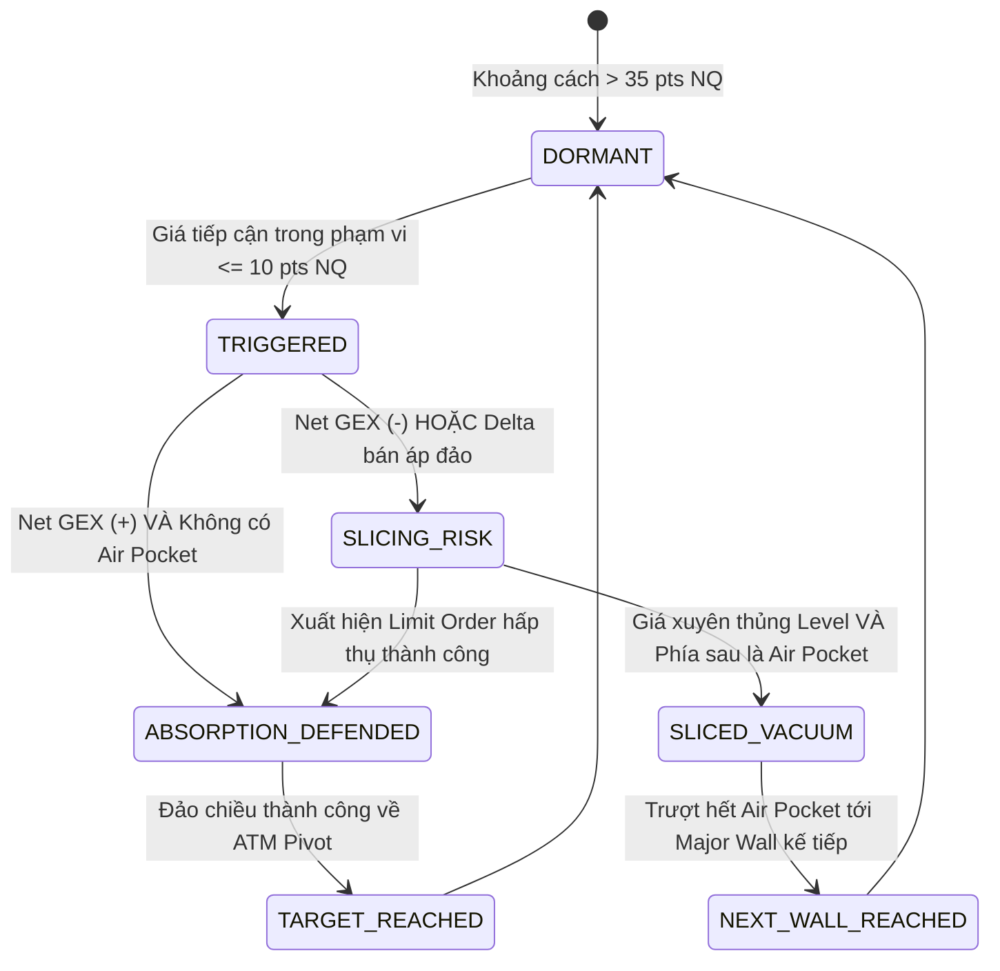

# Kiến trúc Hệ thống: Cloud-Native Automation & Quant Terminal cho E-mini Nasdaq

> **Project:** Neiro-NQ-Quant  
> **Phiên bản:** v3.1 (Cloud-Native Zero-Touch Automation & Dual-View Microstructure Terminal)  
> **Tài sản mục tiêu:** E-mini Nasdaq-100 Futures (`NQ` / `NQZ26`), Micro E-mini (`MNQ`), Spot Broker Index (`NAS100` / `US100`), và Invesco QQQ Trust Options.

---

## I. TỔNG QUAN KIẾN TRÚC TOÀN CẢNH (END-TO-END PIPELINE)

Hệ thống được thiết kế theo tư duy **Cloud-Native 100% & Zero-Waste**, vận hành hoàn toàn tự động trên **GitHub Actions Runner** theo **Lưới Cron Đa Tầng Pre-Session Radar & Dual-Stage Thích Ứng 2 Mùa**, tự động xuất bản lên **GitHub Pages**, giải phóng hoàn toàn máy tính người dùng:

```
+-----------------------------------------------------------------------------------+
|                        TẦNG 1: NGUỒN DỮ LIỆU ĐÁM MÂY (LIVE & FREE)                |
|    - yfinance API (QQQ Options Chains: 150+ Strikes, 0DTE Hàng Ngày)              |
|    - Tốc độ siêu tốc < 4 giây, không tốn Chromium 300MB, vượt Cloudflare          |
|    - US Treasury Yield 3M (Risk-Free Rate r) & Tỷ giá Futures CME                 |
|    - Dynamic DTE: Đếm ngược từng phút theo giờ New York (America/New_York)        |
|    - Benchmark Synthetic Chain Generator dự phòng khi ngoài giờ giao dịch         |
+-----------------------------------------------------------------------------------+
                                          │
                                          ▼
+-----------------------------------------------------------------------------------+
|               TẦNG 2: THU THẬP & CHUẨN HÓA (COLLECTOR & DATA ENGINE)               |
|    - symbols_resolver: Tự động phát hiện ngày đáo hạn gần nhất (0DTE/Weekly).     |
|    - chain_fetcher: Quét toàn bộ Calls & Puts (Bid, Ask, Mid, Volume, OI, IV).    |
|    - clean_num NaN-Safe: Triệt tiêu hoàn toàn lỗi lan truyền NaN từ sàn.          |
|    - basis_mapper: Ánh xạ chuẩn xác giữa QQQ/NDX và HĐTL E-mini NQ ($20/pt).      |
+-----------------------------------------------------------------------------------+
                                          │
                    ┌─────────────────────┴─────────────────────┐
                    ▼                                           ▼
+-----------------------------------------+   +-------------------------------------+
|    TẦNG 3: CLOUD STORAGE & CI/CD        |   |   TẦNG 4: LÕI BLACK-76 QUANT ENGINE |
|                                         |   |                                     |
|  [GitHub Actions Pre-Session Radar Grid]|   |  - Black-76 Valuation ($e^{-rT}$)   |
|  14 runs/ngày (CME, Âu 2 nấc, Mỹ 0DTE)  |   |  - Hybrid Newton-Brent IV Solver    |
|  Chạy tự động đón đầu mở phiên 30-45p   |   |  - Greeks Bậc 1 & 2: Δ, Γ, ν, V, C  |
|                                         |   |  - Đạo hàm Giải tích Charm CHEX     |
|  [Snapshot & Parquet Storage]           |   |  - Put-Call Parity Synthetic Pivot  |
|  options_prices_NQZ26.csv (< 50KB)      |   |  - Net GEX ($M/1%), Net VEX, CHEX   |
|  Zero-Waste Mandate (< 15MB toàn repo)  |   |  - Brenner-Subrahmanyam 1-Sigma EM  |
|                                         |   |  - Rule of 16 Intraday Volatility   |
|                                         |   |  - Squeeze & Waterfall Triggers     |
|                                         |   |  - Level State Machine Engine       |
+-----------------------------------------+   +-------------------------------------+
                    │                                           │
                    └─────────────────────┬─────────────────────┘
                                          ▼
+-----------------------------------------------------------------------------------+
|             TẦNG 5: TERMINAL HUD ĐA CHẾ ĐỘ DUAL-VIEW & GITHUB PAGES               |
|  [Header Navigation]: Chuyển đổi linh hoạt giữa 2 chế độ tác chiến chuyên sâu:    |
|                                                                                   |
|  [TAB 1: ATAS ORDERFLOW FOOTPRINT]                                                |
|    - Canvas HTML5 Dark Theme 60 FPS phong cách ATAS / Sierra Chart.               |
|    - Thang giá dọc (Vertical Price Ladder), Volume Profile, Bid/Ask Footprint,    |
|      Nến vi mô (Micro-candles), Sổ khớp lệnh Tick-by-Tick & Lưới cản Options.     |
|    - Hỗ trợ tùy chỉnh đòn bẩy E-mini NQ ($20/pt) hoặc Micro MNQ ($2/pt).          |
|                                                                                   |
|  [TAB 2: 3-PANEL QUANT LADDER & TACTICAL PLAYBOOK]                                |
|    - Bố cục 3 Panels thang giá ngang Plotly tương tác:                            |
|      * Panel 1: Net GEX Profile ($M) & Mốc Chiến Thuật Dynamic (SL/TP dynamic)    |
|      * Panel 2: Khối lượng (Volume) vs Mật độ Open Interest nén tổ chức           |
|      * Panel 3: Greeks Bậc 2 tương tác (Vanna & Charm Flow)                       |
|    - Thuật toán Chống Đè Chữ (Anti-Collision Layout: y=1.07, x=0.98, yshift)       |
|    - 2 Bảng Kịch bản Chiến thuật: Intraday Scalping & Structural Swing Walls      |
|    - Bảng Phân tích Vi mô Từng Strike (Call/Put OI, Volume, Greeks, Air Pocket)   |
|                                                                                   |
|  [EXPORTS & FEEDS]                                                                |
|    - Đồng bộ độ lệch Spot Broker MT5 qua tham số --basis                          |
|    - Xuất feed JSON nq_tactical_levels.json kèm đầy đủ tactical_recommendations   |
|    - Tự động Deploy lên GitHub Pages (gh-pages) xem trực tiếp trên mọi thiết bị   |
+-----------------------------------------------------------------------------------+
```

---

## II. LƯỚI CRON ĐA TẦNG PRE-SESSION RADAR & PHÂN TẦNG LƯU TRỮ

### 1. Lưới Cron Đa Tầng Pre-Session Radar & Dual-Stage 0DTE

Hệ thống thiết lập **3 Khối Cron chuyên biệt** (`14 lần chạy/ngày, Thứ 2 - Thứ 6`) trong file workflow [`.github/workflows/daily_options_sync.yml`](file:///c:/Users/Daniel/Documents/My-Projects/Neiro-NQ-Quant/.github/workflows/daily_options_sync.yml):

```yaml
on:
  schedule:
    # 1. Chot Open Interest ngay moi tu CME Clearing (07:15 VN):
    - cron: '15 0 * * 1-5'

    # 2. Phien Au 2 nac (Pre-Europe & In-Session Europe thich ung ca 2 mua):
    - cron: '30 5,6,7,8 * * 1-5'

    # 3. Phien My don tin vi mo (18:45 VN), gio cao diem NYSE & 0DTE Power Hour (02:45 VN):
    - cron: '45 11,12,13,14,15,16,17,18,19 * * 1-5'
```

#### Ma trận Lịch trình Tác chiến (UTC vs Giờ Việt Nam):

| Khối | Giờ UTC | Giờ VN (UTC+7) | Sự kiện Thị trường & Mục đích Tác chiến |
|---|---|---|---|
| **Khối 1: CME Clearing** | **00:15 UTC** | **07:15 VN** | **Chốt Open Interest CME Clearing & OCC:** OCC & CME công bố sổ lệnh OI chính thức cho ngày mới. Vì OI giữ tĩnh suốt cả ngày giao dịch, bước này chốt cố định **Call Wall, Put Wall & Max Pain** khung ngày chuẩn xác 100%. |
| **Khối 2: Phiên Âu Nấc 1** | **05:30 UTC** | **12:30 VN** | **Pre-Europe Radar (Mùa Hè):** Quét trước khi sàn Frankfurt mở (13:00 VN) và London mở (14:00 VN) 30–90 phút để lên kịch bản đánh Futures NQ Globex / US100 ban ngày. |
| | **06:30 UTC** | **13:30 VN** | **Pre-Europe Radar (Mùa Đông):** Quét trước khi sàn Frankfurt mở (14:00 VN) và London mở (15:00 VN) khi Châu Âu chuyển giờ mùa đông. |
| **Khối 2: Phiên Âu Nấc 2** | **07:30 UTC** | **14:30 VN** | **In-Session Europe (Mùa Hè):** Cập nhật sau khi London chạy 30 phút, đo lường phản ứng giá thực tế và dịch chuyển Delta/Gamma tức thời. |
| | **08:30 UTC** | **15:30 VN** | **In-Session Europe (Mùa Đông):** Cập nhật sau khi London chạy 30 phút trong mùa đông. |
| **Khối 3: Pre-US Macro** | **11:45 UTC** | **18:45 VN** | **Pre-US Macro News Radar:** Đón đầu trước các tin tức vĩ mô tối quan trọng của Mỹ (CPI, PPI, Non-Farm Payrolls lúc 19:30 hè / 20:30 đông) từ 45-105 phút. |
| **Khối 3: Pre-Market US** | **12:45 UTC** | **19:45 VN** | **Pre-Market NYSE (Mùa Hè):** Quét trước giờ mở cửa sàn giao dịch chứng khoán New York (20:30 VN) 45 phút. |
| **Khối 3: Cao điểm Phiên Mỹ** | **13:45 UTC** | **20:45 VN** | **In-Session Mùa Hè** (sau mở cửa 15p, options QQQ bắt đầu có volume thực) / **Pre-Market NYSE Mùa Đông** (trước mở cửa 21:30 VN 45 phút). |
| | **14:45 UTC** | **21:45 VN** | **Cao điểm sôi động Mùa Hè (10:45 AM EDT)** / **In-Session Mùa Đông** (sau mở cửa 15p). |
| | **15:45 UTC** | **22:45 VN** | **Xuyên suốt giữa phiên Mỹ (Mid-Session):** Cập nhật biến động Volatility Squeeze & dịch chuyển Put-Call Parity. |
| | **16:45 UTC** | **23:45 VN** | **Đón đầu London Fix (00:00 VN):** Nhịp tái cân bằng dòng tiền giữa 2 lục địa Âu - Mỹ. |
| | **17:45 UTC** | **00:45 VN** | **Nửa sau phiên Mỹ:** Theo dõi sự hấp thụ thanh khoản và xu hướng phiên chiều New York. |
| | **18:45 UTC** | **01:45 VN** | **Chuẩn bị vào Giờ Vàng Power Hour (14:45 EDT / 13:45 EST):** Nhận diện các bẫy thanh khoản cuối ngày. |
| **Khối 3: 0DTE Power Hour** | **19:45 UTC** | **02:45 VN** | **0DTE Power Hour Radar & Market Close:** Đón đầu trước khi sàn NYSE đóng cửa (03:00 hè), bắt trọn áp lực **Gamma Pinning / Gamma Unwind** khốc liệt của các nhà tạo lập thị trường đối với hợp đồng 0DTE đáo hạn trong ngày. |

### 2. Phân tầng Lưu trữ & Zero-Waste

| Tầng lưu trữ | Nền tảng | Định dạng | Mục đích | Chi phí & Tài nguyên |
|---|---|---|---|---|
| **Ephemeral Runner** | GitHub Actions Ubuntu | In-Memory | Chạy pipeline thu thập, giải Black-76 và xuất HTML (< 20 giây) | 0 VNĐ (GitHub Free Tier 2,000 phút/tháng) |
| **Active Options Snapshot** | GitHub Repository | CSV (`data/options_prices_NQZ26.csv`) | Lưu trữ snapshot phục vụ chạy benchmark và fallback | Dung lượng < 50 KB |
| **Interactive Terminal Web** | GitHub Pages (`gh-pages`) | HTML độc lập (`exports/index.html`) | Truy cập trực tiếp qua link Web trên điện thoại / PC | 0 VNĐ (Miễn phí vĩnh viễn) |
| **Tactical Levels Feed** | GitHub Pages (`gh-pages`) | JSON (`exports/nq_tactical_levels.json`) | Nạp vào Bot Telegram, Discord hoặc MetaTrader EA | Dung lượng < 10 KB |
| **Cold Storage (Tùy chọn)** | Google Drive | Apache Parquet (Snappy) | Lưu giữ toàn bộ snapshot lịch sử Options Chain theo từng phút/phiên | 0 VNĐ (Dùng Google Drive cá nhân, nén 85%) |

---

## III. THIẾT KẾ CHI TIẾT COLLECTOR & CƠ CHẾ DYNAMIC DTE

### 1. Vì sao chọn QQQ Options làm Proxy số 1 cho E-mini Nasdaq?

- **Khối lượng giao dịch khổng lồ:** QQQ là một trong những tài sản có thanh khoản Options lớn nhất thế giới, tập hợp đầy đủ các Market Makers hàng đầu (Citadel, Jane Street, Susquehanna, Virtu).
- **Kỳ hạn 0DTE hàng ngày:** QQQ đáo hạn mỗi ngày (Thứ 2 đến Thứ 6), tạo ra áp lực tái phòng hộ (Gamma Scalping / 0DTE Hedging) trực tiếp lên chỉ số Nasdaq-100 và Hợp đồng Tương lai E-mini Nasdaq (`NQ`).
- **Tỷ lệ ánh xạ (Basis Ratio):**
  $$NQ_{\text{Price}} \approx QQQ_{\text{Price}} \times \text{Basis Factor}$$
  Mọi bức tường Call Wall, Put Wall, và vùng chân không của QQQ đều được nhân với hệ số này để ra mốc giá E-mini Nasdaq tương ứng.

### 2. Chu trình Thu thập & Chuẩn hóa (Collection Workflow)

```
[Khởi động Collector: src/collector/nasdaq_collector.py]
          │
          ▼
[1. Quét danh sách Expiration Dates của QQQ qua yfinance]
          │
          ▼
[2. Tính toán Target DTE theo Giờ New York (America/New_York)]
    - Nếu là 0DTE và đang trong phiên giao dịch:
      T_days = max(0.01, (16:00 ET - now_et).total_seconds() / 86400)
    - Nếu ngoài giờ giao dịch / qua đêm: DTE chốt theo số ngày lịch
          │
          ▼
[3. Tải toàn bộ Calls Chain & Puts Chain]
    - Strike, Bid, Ask, Mid, Last Price, Volume, Open Interest, Implied Volatility
    - LUÔN DÙNG Mid = (Bid + Ask) / 2
    - Áp dụng clean_num() khử bỏ triệt để NaN
          │
          ▼
[4. Giải bài toán Vectorized Greeks (Black-76 Engine)]
    - Tính toán chính xác Delta, Gamma, Vega, Vanna, Charm cho từng Strike
          │
          ▼
[5. Đẩy dữ liệu vào Lõi Quant Engine để sinh Bảng Chiến thuật & Dual-View HTML]
```

---

## IV. CÂY TRI THỨC ĐỊNH LƯỢNG 3 TẦNG & CÔNG THỨC TOÁN HỌC CHUẨN XÁC

```
               [TIER 3: DEALER POSITIONING & RISK ENVELOPE]
         Call Wall #1 | Put Wall #1 | Pin Risk Magnet | Squeeze Triggers
                         Air Pockets (< 35% OI Mean)
                                      ▲
                                      │
                 [TIER 2: IMPLIED VALUATION & STRADDLE BANDS]
            Synthetic ATM Pivot (Put-Call Parity) | ATM Straddle
            ±1.0σ Implied Bands | ±0.85σ 0DTE Conservative Bands
                                      ▲
                                      │
               [TIER 1: MARKET MICROSTRUCTURE & LIQUIDITY]
            Mid-Price = (Bid + Ask)/2 | Pure Open Interest (OI)
                     Vectorized Greeks (Δ, Γ, ν, Vanna, Charm)
```

### 1. Tier 1: Cấu trúc Vi mô & Mô hình Định giá Black-76

Đối với Hợp đồng Tương lai NQ Futures Options, mô hình định giá chuẩn mực là Black-76 với giá Forward $F$ và lãi suất phi rủi ro $r$:

$$d_1 = \frac{\ln(F/K) + \frac{1}{2}\sigma^2 T}{\sigma \sqrt{T}}, \quad d_2 = d_1 - \sigma \sqrt{T}$$

- **Quyền chọn Mua (Call):** $C = e^{-rT} [F N(d_1) - K N(d_2)]$
- **Quyền chọn Bán (Put):** $P = e^{-rT} [K N(-d_2) - F N(-d_1)]$
- **Độ nhạy Delta ($\Delta$):**
  $$\Delta_{\text{Call}} = e^{-rT} N(d_1), \quad \Delta_{\text{Put}} = -e^{-rT} N(-d_1)$$
- **Gia tốc Gamma ($\Gamma$):**
  $$\Gamma = e^{-rT} \frac{N'(d_1)}{F \sigma \sqrt{T}}$$
- **Độ nhạy Biến động Vega ($\nu$):**
  $$\nu = e^{-rT} F \sqrt{T} N'(d_1)$$
- **Độ nhạy Bậc 2 Vanna ($VEX$):**
  $$\text{Vanna} = \frac{\partial \Delta}{\partial \sigma} = -e^{-rT} N'(d_1) \frac{d_2}{\sigma}$$
- **Độ nhạy Thời gian Charm ($CHEX = -\partial \Delta / \partial T$):**
  $$\text{Charm}_{\text{Call}} = e^{-rT} \left[ r N(d_1) + N'(d_1) \frac{d_2}{2T} \right]$$
  $$\text{Charm}_{\text{Put}} = e^{-rT} \left[ -r N(-d_1) + N'(d_1) \frac{d_2}{2T} \right]$$

### 2. Tier 2: Trục Định giá Ngầm định (Implied Valuation)

- **Synthetic ATM Pivot ($S_{\text{Implied}}$):** Tìm Strike $K_{\text{ATM}}$ có $|Call_{\text{mid}} - Put_{\text{mid}}|$ nhỏ nhất theo Put-Call Parity:
  $$S_{\text{Implied}} = K_{\text{ATM}} + e^{rT} \left( Call_{\text{mid}} - Put_{\text{mid}} \right)$$
- **Biên độ Kỳ vọng (ATM Straddle):**
  $$\text{Straddle} = Call_{\text{mid}}(ATM) + Put_{\text{mid}}(ATM)$$
- **Dải Biên độ 1-Sigma:**
  $$\text{Upper Band } (+1\sigma) = S_{\text{Implied}} + \text{Straddle}$$
  $$\text{Lower Band } (-1\sigma) = S_{\text{Implied}} - \text{Straddle}$$

### 3. Tier 3: Vị thế Nhà tạo lập & Kích hoạt Bẫy Thanh khoản

- **Call Wall #1:** Strike có $OI_{\text{Call}}$ lớn nhất $\rightarrow$ Trần kháng cự phòng hộ dương Gamma.
- **Put Wall #1:** Strike có $OI_{\text{Put}}$ lớn nhất $\rightarrow$ Bệ đỡ hỗ trợ phòng hộ âm Gamma.
- **Pin Risk Magnet (Hố đen ghim giá):** Strike có tổng $(OI_{\text{Call}} + OI_{\text{Put}})$ cao nhất toàn thị trường.
- **Gamma Squeeze Trigger (Vượt đỉnh ép mua):**
  $$\text{Trigger}_{\text{Up}} = K_{\text{CallWall}} + C_{\text{mid}}(K_{\text{CallWall}})$$
- **Waterfall Trigger (Thủng đáy ép bán tháo):**
  $$\text{Trigger}_{\text{Down}} = K_{\text{PutWall}} - P_{\text{mid}}(K_{\text{PutWall}})$$
- **OI Air Pockets (Vùng chân không thanh khoản):** Các strike có $OI < 0.35 \times \text{Mean}(OI_{\text{all}})$.

---

## V. CƠ CHẾ STATE MACHINE CHO TỪNG LEVEL (LEVEL STATE ENGINE)

Hệ thống giám sát khoảng cách giá thực tế của E-mini Nasdaq tới các mốc cản theo chu trình State Machine:



### Quy tắc xác định Stop Loss & Take Profit:
1. **Mốc Cản Có Xu Hướng Rõ Rệt (Call Wall / Put Wall):**
   - **Call Wall (Kháng cự):** Kịch bản Reversal Short $\rightarrow$ SL đặt phía trên cản (cộng thêm vùng đệm), TP nhắm về Strike bên dưới hoặc Trục Synthetic Pivot.
   - **Put Wall (Hỗ trợ):** Kịch bản Reversal Long $\rightarrow$ SL đặt phía dưới cản (trừ đi vùng đệm), TP nhắm về Strike bên trên hoặc Trục Synthetic Pivot.
2. **Mốc Cản Trung Tính / Hai Chiều (ATM Synthetic Pivot, Pin Risk Magnet, Gamma Flip):**
   - Nếu giá hiện tại đang ở **trên** Level: Level đóng vai trò là **Hỗ trợ** $\rightarrow$ Kịch bản Long với SL bên dưới Level và TP hướng lên Strike liền trên.
   - Nếu giá hiện tại đang ở **dưới** Level: Level đóng vai trò là **Kháng cự** $\rightarrow$ Kịch bản Short với SL bên trên Level và TP hướng xuống Strike liền dưới.

---

## VI. THIẾT KẾ GIAO DIỆN TÁC CHIẾN ĐA CHẾ ĐỘ DUAL-VIEW

Giao diện HTML độc lập được tạo bởi [`src/hud/html_dashboard.py`](file:///c:/Users/Daniel/Documents/My-Projects/Neiro-NQ-Quant/src/hud/html_dashboard.py) (với [`src/dashboard/html_dashboard.py`](file:///c:/Users/Daniel/Documents/My-Projects/Neiro-NQ-Quant/src/dashboard/html_dashboard.py) đóng vai trò là alias tương thích ngược).

### 1. Navigation Header & Cơ chế Chuyển View (Tab Switching Engine)
Người dùng có thể chuyển đổi tức thì giữa 2 góc nhìn thông qua các nút chuyển tab trên thanh Header:
- `switchTerminalView('atas')`: Hiển thị Tab 1 (Canvas ATAS Orderflow Footprint).
- `switchTerminalView('ladder')`: Hiển thị Tab 2 (Plotly 3-Panel Quant Ladder, KPI Cards và Bảng Kịch bản Chiến thuật).

```javascript
function switchTerminalView(view) {
  var atasTab = document.getElementById('tab-atas-view');
  var ladderTab = document.getElementById('tab-ladder-view');
  var btnAtas = document.getElementById('btn-nav-atas');
  var btnLadder = document.getElementById('btn-nav-ladder');
  if (view === 'atas') {
    atasTab.style.display = 'block';
    ladderTab.style.display = 'none';
    btnAtas.className = 'tab-btn active';
    btnLadder.className = 'tab-btn';
    window.dispatchEvent(new Event('resize'));
  } else {
    atasTab.style.display = 'none';
    ladderTab.style.display = 'block';
    btnAtas.className = 'tab-btn';
    btnLadder.className = 'tab-btn active';
    window.dispatchEvent(new Event('resize'));
  }
}
```

### 2. Tab 1: ATAS Orderflow Footprint Terminal
- Sử dụng thẻ `<canvas>` HTML5 kết hợp JavaScript thuần để vẽ sổ lệnh thang giá dọc ở tần số 60 FPS.
- Cột giá trung tâm (Price Column) hiển thị chi tiết các mốc cản Options (Call Wall, Put Wall, ATM Pivot, Gamma Flip, Squeeze Triggers).
- Cột Bid/Ask Volume Footprint phản ánh lực mua/bán chủ động tức thời tại từng nấc giá.
- Bảng nến vi mô (Micro-Candles) và Bảng dòng lệnh Tick-by-Tick Tape.
- Tự động áp dụng hệ số đòn bẩy `multiplier` ($20 cho NQ, $2 cho MNQ).

### 3. Tab 2: 3-Panel Plotly Quant Ladder & Tactical Playbook
- **Panel 1 (Trái): Net GEX Profile ($M):** Thang giá ngang thể hiện áp lực phòng hộ ròng của Dealer. Tích hợp vị trí Spot Futures, Spot MT5, Synthetic ATM Pivot, các Wall và dải Expected Move.
- **Panel 2 (Giữa): Khối lượng (Volume) vs Open Interest nén:** Cột xanh lá thể hiện thanh khoản Volume trong ngày, đường bậc thang vàng thể hiện mật độ vị thế mở Open Interest của các quỹ tổ chức.
- **Panel 3 (Phải): Greeks Bậc 2 Tương tác (Vanna & Charm Flow):** Đường xanh lục thể hiện dòng tiền nhạy IV (Vanna) và đường tím thể hiện dòng tiền phân rã thời gian (Charm).
- **Thuật toán Chống Đè Chữ (Anti-Collision Architecture):**
  * Legend dịch chuyển ra ngoài đồ thị ($y = 1.07$, hướng ngang).
  * Spot CME Futures neo mép phải ($x = 0.98$, $y_{\text{ref}} = \text{paper}$).
  * Tự động giãn khoảng cách dọc nếu đỉnh Vanna và Charm trùng Strike.
- **Bảng Intraday Scalping Strategy:** Cung cấp hướng dẫn hành động cụ thể (Level, Giá NQ, Trạng thái State Machine, Hành động Action, Hướng dẫn vào lệnh Entry Guide, Mức Stop Loss, Mức Take Profit).
- **Bảng Structural Swing Walls:** Mốc thành trì kiên cố cho các vị thế giữ dài hạn.
- **Bảng Strike Microstructure Matrix:** Phân tích chi tiết từng Strike trên chuỗi Options (Call/Put OI, Volume, Greeks, Cảnh báo Air Pocket).

### 4. Đồng bộ Sàn Spot MT5 / Broker Index (`--basis`)
Thị trường Spot CFD tại các sàn giao dịch MT5 (`NAS100` / `US100`) thường có độ lệch giá (Basis Offset) từ 0 đến 30 điểm so với Hợp đồng Tương lai CME Futures (`NQZ26`):
$$Spot_{\text{MT5}} = Spot_{\text{Futures}} - \text{Basis}$$
Hệ thống hiển thị đồng thời cả giá CME Futures chuẩn và giá Spot MT5 tương ứng trên mọi KPI Card và bảng chiến thuật.

---

## VII. ĐẶC TẢ MODULE & MỐI QUAN HỆ MÃ NGUỒN

| Module | File | Vai trò & Chức năng |
|---|---|---|
| **Collector** | `src/collector/nasdaq_collector.py` | Quét Options QQQ qua `yfinance`, tính dynamic DTE giờ NY, hàm `clean_num()`, tạo benchmark chain |
| **Greeks Legacy** | `src/collector/greeks.py` | Lớp tính Greeks Black-Scholes cơ bản (đã chuẩn hóa Charm) |
| **Storage** | `src/collector/storage.py` | Đọc/ghi dữ liệu Parquet và quản lý DuckDB |
| **Black-76 Model** | `src/quant_engine/black76.py` | Định giá Black-76 cho Futures Options, bộ giải Newton-Brent IV, Greeks giải tích bậc 1 & 2 (Delta, Gamma, Vega, Vanna, Charm) |
| **Quant Engine** | `src/quant_engine/engine.py` | Tính Net GEX, VEX, CHEX, Put-Call Parity Synthetic Pivot, Squeeze/Waterfall Triggers, Expected Move |
| **Microstructure** | `src/quant_engine/structure.py` | Phát hiện Air Pockets, phân tích mật độ thanh khoản và cấu trúc vi mô |
| **State Machine** | `src/quant_engine/state_machine.py` | Mô hình hóa trạng thái từng level (Dormant, Triggered, Absorption, Slicing Risk), tính toán SL/TP đa chiều |
| **Tactical HUD** | `src/hud/html_dashboard.py` | Generator chính xuất Terminal Đa Chế Độ Dual-View (ATAS Footprint + Plotly 3-Panel) và JSON Feed |
| **Dashboard Wrapper** | `src/dashboard/html_dashboard.py` | Wrapper tương thích ngược, import và forward toàn bộ hàm từ `src/hud/html_dashboard.py` |
| **Pipeline Runner** | `src/main.py` | Entrypoint điều phối luồng thực thi khép kín |
